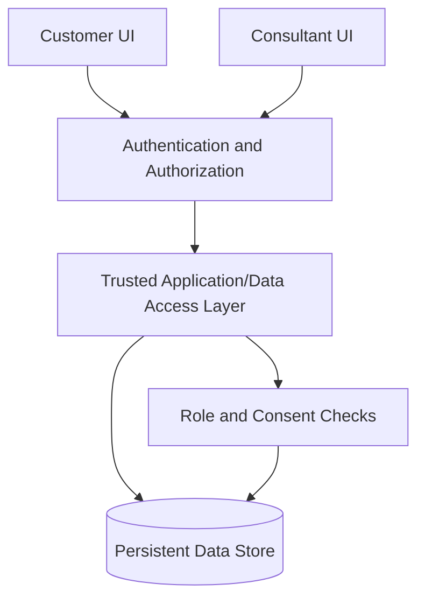

# Architecture

> Status: **Planned architecture only.** The project is currently at the mockup stage and has no confirmed frontend implementation. Update this document after inspecting the repository and deciding the stack.

## System Overview
The intended product has two role-specific web experiences—customer and consultant—over shared customer, asset, expense, consent, and simulated-history data. Access must be enforced by trusted backend/data-access controls.

## System Diagram

This is a conceptual target diagram, not a description of an implemented system.

## Tech Stack
- **Confirmed:** No implementation stack confirmed; frontend has not started.
- **Candidate discussed, not decided:** React + TypeScript + Vite, Supabase/PostgreSQL, and Recharts.
- Do not treat the candidate stack as approved until explicitly selected.

## Repository Structure
Not yet available for inspection. Fill in after the repository is created or provided.

## Application Layers
Planned responsibilities, independent of specific technology:
- **Presentation:** customer and consultant pages, forms, tables, charts, loading/empty/error states.
- **Authentication and authorization:** identifies the user and enforces role and record-level permissions.
- **Domain/data access:** validates and reads/writes customer, asset, expense, recurring-expense, consent, and simulated-history records.
- **Persistence:** stores data so changes survive navigation and sessions.

The eventual implementation may combine or split these layers according to the selected stack.

## Database Architecture
Not implemented or decided. The eventual data model is expected to represent users/roles, customer profiles, assets, expenses, recurring expenses, consent state, and simulated monthly history. Final schema, relations, constraints, and migrations must be based on confirmed requirements.

## API Architecture
Not implemented or decided. Document actual endpoints or server actions after the application approach is selected.

## External Services
None confirmed. Do not add external financial-data integrations to the MVP.

## Data Flow
1. User authenticates.
2. The application determines the authenticated user's role from trusted data.
3. A request to read or change a customer record is authorized against that identity and the relevant permissions.
4. Consultant expense access is allowed only when the customer has active consent.
5. Validated changes are persisted and reflected in the relevant views.

## Architectural Patterns
Not yet established. Prefer the smallest architecture that supports persistent demo data, role separation, and enforceable consent without unnecessary complexity.

## System Boundaries
- Customer and consultant interfaces are distinct experiences.
- Customer records are shared domain data, not duplicated per interface.
- Consent for expense visibility is an authorization boundary.
- Synthetic demo data is not a live financial data source.

## Scalability Considerations
The hackathon MVP prioritizes correctness, clarity, and reliable demonstration over premature scaling. Avoid choices that prevent future extension, but do not build speculative infrastructure.

## Security Architecture
- Enforce authorization at a trusted server/database boundary.
- Derive roles and identity from authenticated records, not arbitrary client-supplied values.
- Restrict each consultant to permitted customer records.
- Check consent whenever consultant expense access is requested.
- Protect secrets and use synthetic data.
- Document and test the selected platform's row-level or equivalent access policies.

## Deployment Architecture
Not decided. Record the actual hosting, environment configuration, and release workflow once selected.

## Architecture Decisions
See `DECISIONS.md`. Candidate technologies are not decisions until explicitly approved.

## Constraints
- Mockups exist; frontend implementation has not started.
- Awesome Design reference is pending.
- Candidate stack is not yet confirmed.
- MVP excludes live brokerage, bank linking, automated statement extraction, and automated investment advice.
